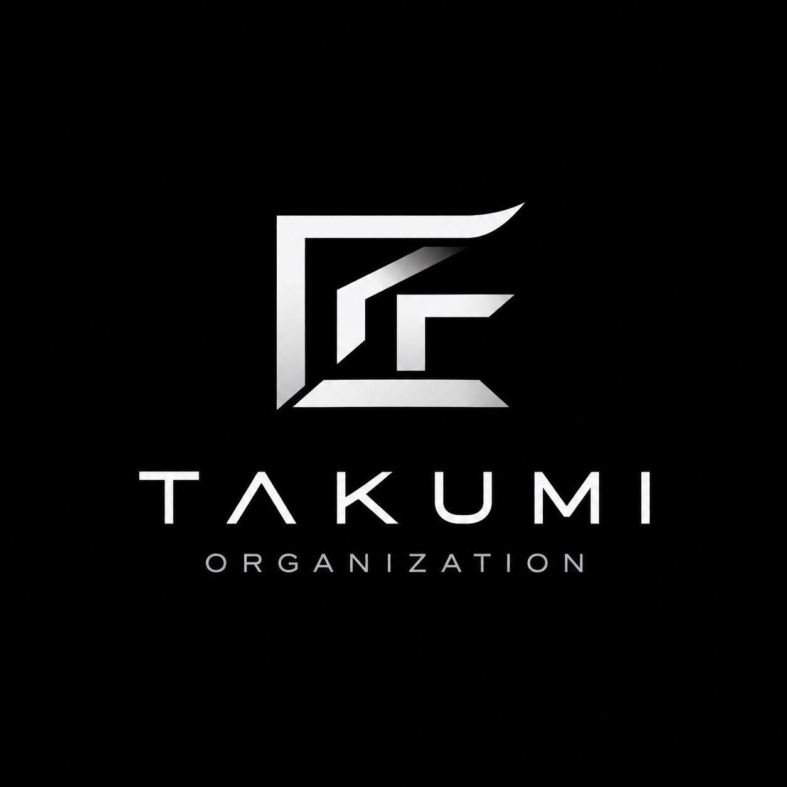

  

# Takumi Organization

Software propio, construido con oficio: aplicaciones móviles, herramientas de terminal, escritorio y aprendizaje automático. Cada proyecto se verifica antes de darse por terminado.

**18 proyectos** · 0 públicos · 18 privados

## Aplicaciones móviles

Android nativo en Kotlin y Jetpack Compose, estilo Ryoku Glass.

| Proyecto | Descripción | Stack |
|---|---|---|
| `cipherkey-mobile` | Cliente Android del gestor de contraseñas CipherKey y servidor de sincronización cifrada de extremo a extremo. | Kotlin, Compose, Java |
| `flow` | Automatización visual para Android: flujos CUANDO / SI / ENTONCES en un lienzo de nodos. | Kotlin, Compose |
| `lumina` | Galería multimedia para Android con cuadrícula cronológica. | Kotlin, Compose |
| `nexus-files` | Explorador de archivos avanzado para Android. | Kotlin, Compose |
| `focus-system` | Planificación y restricciones de apps: núcleo, escritorio y Android. | Python, FastAPI, PySide6, Kotlin |
| `ClaudeBridge` | Manda tareas a Claude Code desde el móvil y recibe la respuesta por Tailscale. | Rust, Kotlin |

## Ryoku y escritorio

Identidad visual y herramientas del escritorio Ryoku.

| Proyecto | Descripción | Stack |
|---|---|---|
| `ryoku-glass` | Identidad visual Ryoku Glass: base opaca, cristal y acento saturado. | HTML, CSS |
| `ryoku-genie` | Minimiza y restaura ventanas al dock con animación tipo Mac. | Python, Hyprland |
| `ryoku-mobile-bridge` | Batería y notificaciones del móvil Android en el escritorio Ryoku. | Kotlin, Ktor, Quickshell, Python |

## Terminal y sistema

Aplicaciones de terminal en Rust y herramientas de desarrollo.

| Proyecto | Descripción | Stack |
|---|---|---|
| `dockTUI` | Sustituto de Docker Desktop en terminal: contenedores, imágenes, volúmenes, redes y Compose. | Rust, Ratatui |
| `editTUI` | Editor de texto de terminal para TUI-OS. | Rust, Ratatui |
| `webTUI` | Navegador de terminal con render a celdas para TUI-OS. | Rust, Ratatui, Firefox |

## IA, datos y verificación

Aprendizaje automático desde cero y evaluación de agentes.

| Proyecto | Descripción | Stack |
|---|---|---|
| `rust-ai-core` | Framework de aprendizaje automático desde cero: tensores y autograd, sin dependencias. | Rust |
| `stockmind` | Aprendizaje automático y por refuerzo aplicado a bolsa. | Python |
| `skillproof` | Laboratorio que mide con estadística si un Agent Skill mejora a un agente. | Python |

## Software y juegos

Aplicaciones de escritorio y juegos.

| Proyecto | Descripción | Stack |
|---|---|---|
| `checkmate` | Ajedrez de escritorio. | C++, Qt 6, QML |
| `null-veil` | Terror en primera persona dibujado con glifos ASCII. | Godot, GDScript |

## Canal y formación

Código de los vídeos y cursos de Low Noise.

| Proyecto | Descripción | Stack |
|---|---|---|
| `curso-java` | Código del curso de Java en vídeo, compilado y ejecutado en JDK 21. | Java 21 |

## Automatización

Este repositorio centraliza lo común a toda la organización:

- **Plantillas de workflow** (`workflow-templates/`): CI para Rust, Node, Python, Java con Maven y Android con Gradle, más un análisis de secretos. Aparecen en la pestaña *Actions → New workflow* de cada repo.
- **Este README** se regenera solo al cambiar `projects.json` (`readme.yml`).
- **Validación** (`validate.yml`): comprueba que el README está al día y que las plantillas son YAML válido.
- **Salud de la comunidad**: política de seguridad, guía de contribución y plantillas de issues y pull requests por defecto.

## Convenciones

- Ramas por funcionalidad; `main` siempre compila y pasa sus pruebas.
- Mensajes de commit en español, en imperativo y concretos.
- Nunca se versionan secretos, `.env` ni `local.properties`.
- Los proyectos nuevos nacen privados y se publican de forma deliberada.
